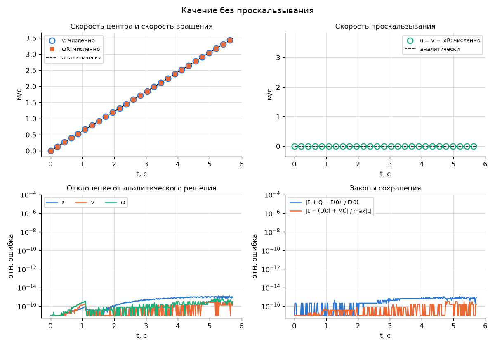
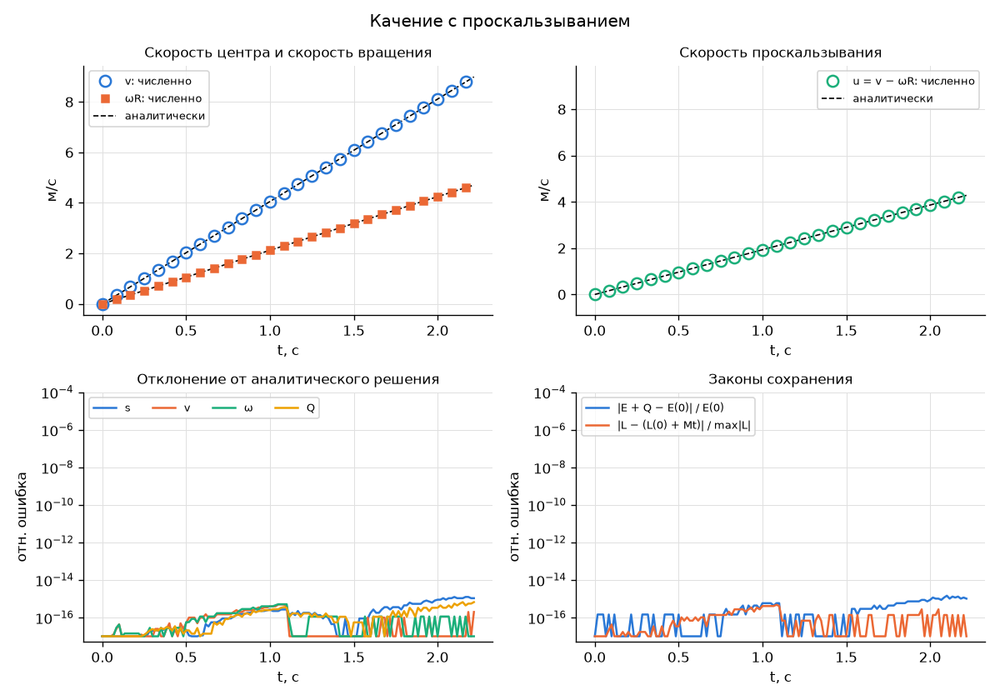
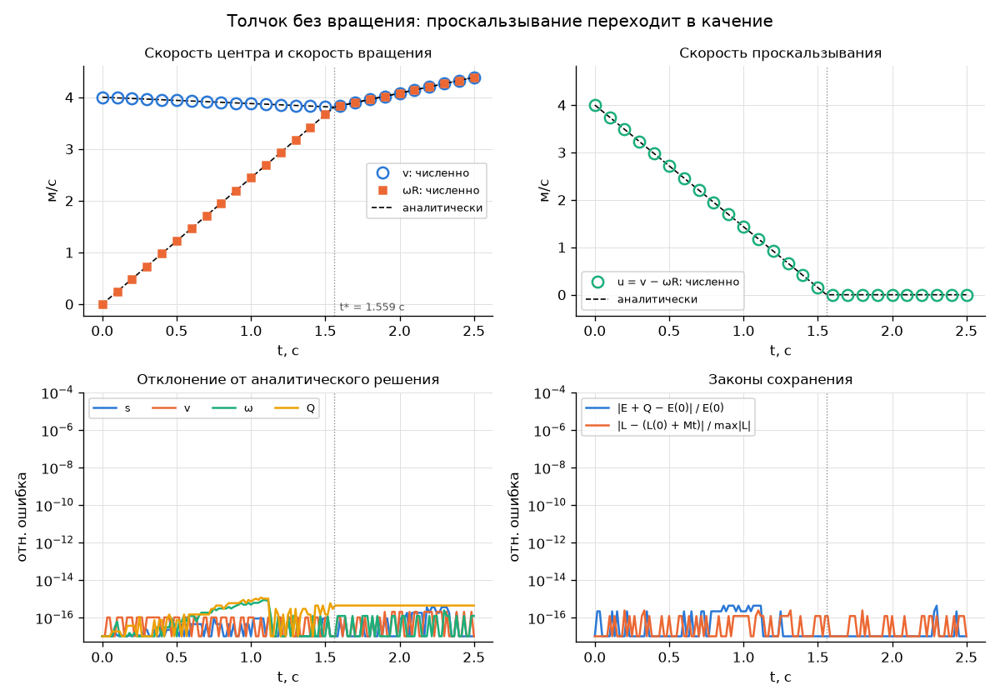

# Качение шара по наклонной плоскости с учётом трения

## 1. Постановка задачи

Однородный сплошной шар массы $m$ и радиуса $R$ находится на верхнем краю наклонной плоскости длины $L$ с углом наклона $\alpha$. Коэффициент трения между шаром и плоскостью равен $\mu$. В начальный момент шару сообщают скорость вдоль склона $v_0$ и угловую скорость $\omega_0$. Построим модель для обоих режимов качения (чистого и с проскальзыванием), проверим законы сохранения энергии и момента импульса, сравним с аналитическим решением.

## 2. Модель

### 2.1. Допущения

- Шар абсолютно твёрдый и однородный, его момент инерции относительно центра $I = \frac{2}{5} m R^2$.
- Плоскость неподвижна и абсолютно жёсткая, шар её не покидает.
- Сопротивление воздуха и трение качения не учитываются.
- Движение плоское: центр шара движется вдоль линии наибольшего ската, ось вращения перпендикулярна плоскости движения.

### 2.2. Координаты и силы

Обозначения:

- $s$ — путь центра шара вдоль склона, отсчитывается от верхнего края вниз по склону;
- $v = \dot s$ — скорость центра;
- $\varphi$ — угол поворота шара, $\omega = \dot\varphi$. Положительное направление $\omega$ соответствует качению вниз по склону.

На шар действуют:

- сила тяжести $m\vec g$;
- сила реакции опоры $N = m g \cos\alpha$;
- сила трения $F$, направленная вдоль склона и приложенная в точке касания.

Уравнения движения центра масс и вращения вокруг центра:

$$
m \dot v = m g \sin\alpha + F, \qquad I \dot\omega = -F R.
$$

Режим движения определяется скоростью точки касания, то есть скоростью проскальзывания:

$$
u = v - \omega R.
$$

### 2.3. Качение без проскальзывания ($u = 0$)

$$
v = \omega R, \qquad
\dot v = \frac{g \sin\alpha}{1 + I / (m R^2)} = \frac{5}{7} g \sin\alpha, \qquad \dot\omega = \frac{\dot v}{R}.
$$

Для такого движения нужна сила трения покоя

$$
F = -\frac{I}{I + m R^2}\, m g \sin\alpha = -\frac{2}{7} m g \sin\alpha.
$$

Трение покоя не может превысить $\mu N$. Отсюда условие, при котором возможно качение без проскальзывания:

$$
\tan\alpha \le \mu \left(1 + \frac{m R^2}{I}\right) = \frac{7}{2}\mu.
$$

### 2.4. Качение с проскальзыванием ($u \ne 0$)

Сила трения скольжения направлена против скорости проскальзывания: $F = -\mu N \operatorname{sign}(u)$. Тогда

$$
\dot v = g\left(\sin\alpha - \mu \cos\alpha \operatorname{sgn} u\right), \qquad
\dot\omega = \frac{5}{2} \frac{\mu g \cos\alpha}{R} \operatorname{sign}(u),
$$

$$
\dot u = g \sin\alpha - \frac{7}{2} \mu g \cos\alpha \operatorname{sign}(u).
$$

При $u > 0$ (шар скользит вперёд или закручен назад) трение тормозит центр и раскручивает шар вперёд. Если $\tan\alpha < \frac{7}{2}\mu$, то $|u|$ убывает до нуля.

### 2.5. Переключение режимов

Начальный режим определяется скоростью $u_0 = v_0 - \omega_0 R$:

- при $u_0 \ne 0$ шар проскальзывает, направление трения $-\operatorname{sign}(u_0)$;
- при $u_0 = 0$ шар катится без проскальзывания, если выполнено условие из п. 2.3. Если оно не выполнено, шар проскальзывает с $u > 0$: сила тяжести разгоняет центр быстрее, чем трение успевает раскрутить шар.

Когда в режиме проскальзывания скорость $u$ обращается в ноль, снова проверяется условие из п. 2.3. При его выполнении шар переходит к качению без проскальзывания и остаётся в этом режиме, потому что параметры склона постоянны. Иначе шар продолжает проскальзывать с $\operatorname{sign}(u) = +1$.

### 2.6. Законы сохранения

**Энергия.** Полная механическая энергия (потенциальная отсчитывается от нижнего края склона)

$$
E = \frac{m v^2}{2} + \frac{I \omega^2}{2} + m g (L - s) \sin\alpha.
$$

Мощность силы трения равна $F u$, поскольку сила приложена в точке касания, движущейся со скоростью $u$. Значит,

$$
\dot E = F u = -\mu N |u|.
$$

При качении без проскальзывания $u = 0$ и энергия сохраняется. При проскальзывании энергия рассеивается, и сохраняется сумма $E + Q$, где

$$
Q(t) = \int_0^t \mu N |u|\, dt
$$

— работа сил трения, перешедшая в тепло.

**Момент импульса.** Возьмём неподвижную точку $O$ на линии склона. Момент импульса шара относительно неё

$$
L_O = m v R + I \omega.
$$

Сила трения лежит на линии склона, поэтому её момент относительно $O$ равен нулю. Моменты нормальной реакции и нормальной составляющей силы тяжести равны по величине и противоположны по знаку. Остаётся момент скатывающей составляющей силы тяжести, приложенной в центре шара на высоте $R$:

$$
\dot L_O = M = m g R \sin\alpha.
$$

Это верно в любом режиме движения. Проверка по уравнениям из п. 2.2: $\frac{d}{dt}(m v R + I\omega) = R(m g \sin\alpha + F) - F R = m g R \sin\alpha$. Следовательно,

$$
L_O(t) = L_O(0) + M t.
$$

Момент импульса не сохраняется, но растёт линейно. Совпадение рассчитанного $L_O(t)$ с этой зависимостью служит проверкой численного решения.

### 2.7. Численный метод

Состояние системы — вектор $(s, v, \varphi, \omega, Q)$. Уравнения интегрируются методом `scipy.integrate.solve_ivp` с допусками $\text{rtol} = 10^{-9}$ и $\text{atol} = 10^{-12}$.

Интегрирование ведётся по участкам. Каждый участок соответствует одному режиму движения и заканчивается одним из событий:

- $s = L$ — шар достиг нижнего края склона, расчёт завершается;
- $s = 0$ при движении вверх — шар вернулся к верхнему краю, расчёт завершается;
- $u = 0$ в режиме проскальзывания — смена режима по правилам п. 2.5.

В момент смены режима скорость $v$ приравнивается к $\omega R$, чтобы погрешность округления не накапливалась.

### 2.8. Область применимости и проверка параметров

Чтобы входные данные соответствовали допущениям модели, параметры проверяются перед расчётом:

| Параметр | Допустимые значения | Обоснование |
|---|---|---|
| $\alpha$ | $[0^\circ, 90^\circ)$ | при $90^\circ$ шар не давит на плоскость, при $\alpha < 0$ это подъём |
| $\mu$ | $[0, 2]$ | рассматриваются только коэффициенты трения реального мира |
| $R$, $m$, $L$ | $> 0$, $R < L$ | шар должен помещаться на склоне |
| $v_0$ | $\ge 0$ | шар стартует с верхнего края и изначально катится вниз |
| время расчёта | $(0, 120]$ с | |
| время прохождения склона | $\ge 0{,}2$ с | иначе движение невозможно отобразить в анимации |
| $v_0 = 0$, $\omega_0 < 0$ | только при $\mu \le \tan\alpha$ | иначе трение сразу уносит шар за верхний край |

## 3. Эксперименты

Во всех экспериментах шар сплошной: $m = 1$ кг, $R = 0{,}3$ м, длина склона $L = 10$ м, $g = 9{,}81$ м/с².

### 3.1 Качение без проскальзывания

**Постановка.** Шар без начальной скорости скатывается со склона $\alpha = 5^\circ$ при $\mu = 0{,}3$. Шар всё время катится без проскальзывания, и механическая энергия сохраняется.

**Запуск.**

```
python src/main.py rolling
```

**Аналитическое решение.** При $v_0 = \omega_0 = 0$:

$$
a = \frac{5}{7} g \sin\alpha \approx 0{,}611\ \text{м/с}^2, \qquad
s(t) = \frac{a t^2}{2}, \qquad v(t) = a t, \qquad \omega(t) = \frac{a t}{R}, \qquad u(t) \equiv 0, \qquad Q(t) \equiv 0.
$$

Шар доходит до нижнего края за $T = \sqrt{2L/a} \approx 5{,}723$ с со скоростью $v(T) = \sqrt{2aL} \approx 3{,}495$ м/с. Проверка энергии: $\frac{m v^2}{2} + \frac{I\omega^2}{2} = \frac{7}{10} m v(T)^2 = m g L \sin\alpha \approx 8{,}55$ Дж.

**Результаты.**



### 3.2 Качение с проскальзыванием

**Постановка.** Шар без начальной скорости скатывается с крутого склона $\alpha = 30^\circ$ при малом трении $\mu = 0{,}1$. Шар проскальзывает на всём пути, скорость проскальзывания растёт линейно, а энергия рассеивается так, что сумма $E + Q$ сохраняется.

**Запуск.**

```
python src/main.py slipping
```

**Аналитическое решение.** При $u > 0$ сила трения равна $F = -\mu m g \cos\alpha$, и из п. 2.4:

$$
a = g(\sin\alpha - \mu\cos\alpha) \approx 4{,}055\ \text{м/с}^2, \qquad
\varepsilon = \frac{5}{2}\frac{\mu g \cos\alpha}{R} \approx 7{,}08\ \text{рад/с}^2,
$$

$$
s(t) = \frac{a t^2}{2}, \qquad v(t) = a t, \qquad \omega(t) = \varepsilon t, \qquad
u(t) = g\left(\sin\alpha - \frac{7}{2}\mu\cos\alpha\right) t \approx 1{,}93\, t,
$$

$$
Q(t) = \int_0^t \mu N u\, dt = \mu m g \cos\alpha \cdot g\left(\sin\alpha - \frac{7}{2}\mu\cos\alpha\right) \frac{t^2}{2}.
$$

Поскольку $u$ растёт и не обращается в ноль, переключения режима нет. Шар доходит до низа за $T = \sqrt{2L/a} \approx 2{,}221$ с. К этому моменту трение рассеивает $Q(T) \approx 4{,}05$ Дж.

**Результаты.**



### 3.3 Переход от проскальзывания к чистому качению

**Постановка.** Шару на склоне $\alpha = 5^\circ$ с $\mu = 0{,}1$ сообщают скорость $v_0 = 4$ м/с без вращения ($\omega_0 = 0$). Начальная скорость проскальзывания $u_0 = 4$ м/с, а условие качения выполнено: $\tan\alpha = 0{,}087 \le 0{,}35$. Гипотеза: трение скольжения тормозит центр и раскручивает шар, пока $u$ не обратится в ноль в момент $t^*$. После этого шар катится без проскальзывания, и потери энергии прекращаются.

**Запуск.**

```
python src/main.py slip_to_roll
```

**Аналитическое решение.** Участок проскальзывания, $0 \le t \le t^*$:

$$
a_1 = g(\sin\alpha - \mu\cos\alpha) \approx -0{,}122\ \text{м/с}^2, \qquad
v(t) = v_0 + a_1 t, \qquad \omega(t) = \varepsilon t, \qquad
u(t) = v_0 - g\left(\frac{7}{2}\mu\cos\alpha - \sin\alpha\right) t.
$$

Проскальзывание прекращается в момент

$$
t^* = \frac{v_0}{g\left(\frac{7}{2}\mu\cos\alpha - \sin\alpha\right)} \approx 1{,}559\ \text{с}.
$$

Скорость в этот момент можно найти независимо из теоремы о моменте импульса. Относительно точки на склоне $L_O(0) = m v_0 R$, а при качении $L_O = m v R + I v / R = \frac{7}{5} m R v$. Тогда

$$
v^* = \frac{5}{7}\left(v_0 + g \sin\alpha \cdot t^*\right) \approx 3{,}809\ \text{м/с}.
$$

Это совпадает с $v_0 + a_1 t^*$ из уравнений движения. До момента $t^*$ шар проходит $s^* \approx 6{,}09$ м. Поскольку $u$ убывает линейно, трение рассеивает

$$
Q = \mu m g \cos\alpha \cdot \frac{v_0 t^*}{2} \approx 3{,}05\ \text{Дж}.
$$

Участок качения, $t > t^*$: решение из п. 3.1 с начальными условиями $s^*$, $v^*$ и ускорением $\frac{5}{7} g \sin\alpha$. Шар доходит до низа за $T \approx 2{,}513$ с, $Q$ после $t^*$ не меняется.

**Результаты.**



## 4. Выводы

1. Модель точно описывает оба режима качения и переходы между ними с учётом описанных допущений. Численное решение совпадает с аналитическим.
2. Закон сохранения энергии выполняется с учётом потерь на трение.
3. Момент импульса подчиняется теореме об изменении момента импульса. Относительно точки на линии склона $L_O(t) = L_O(0) + m g R \sin\alpha \cdot t$ в любом режиме, потому что сила трения лежит на этой линии.
